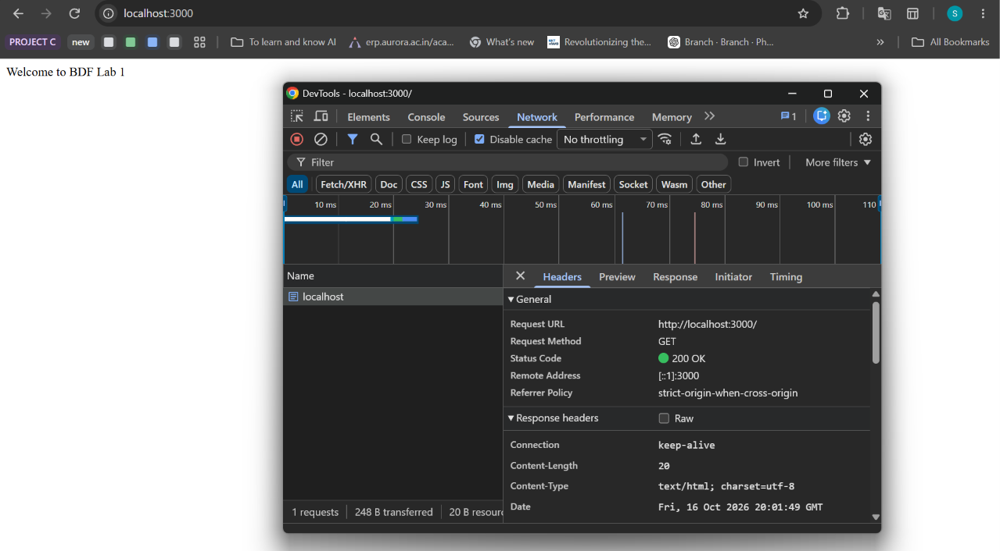
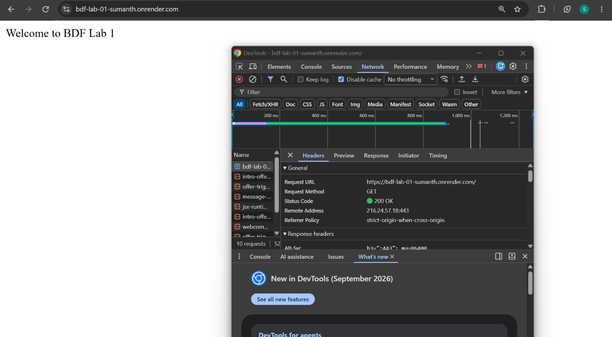
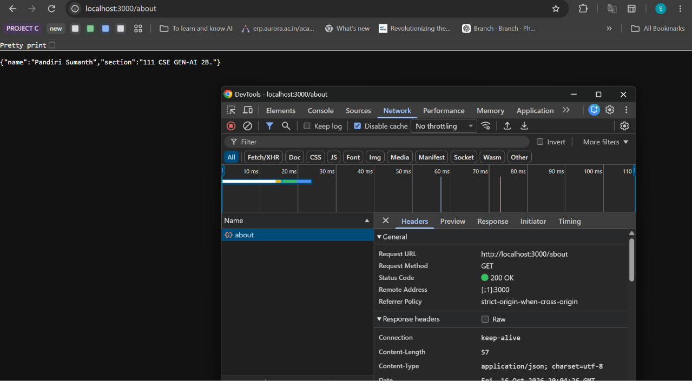
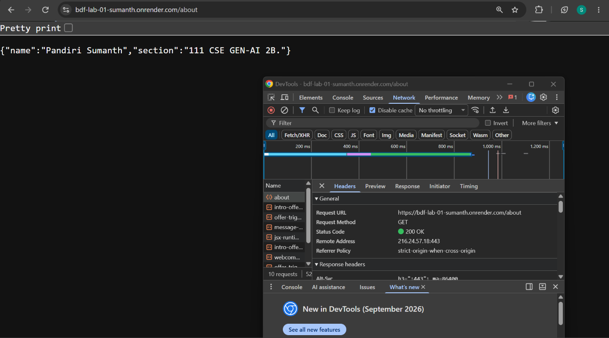
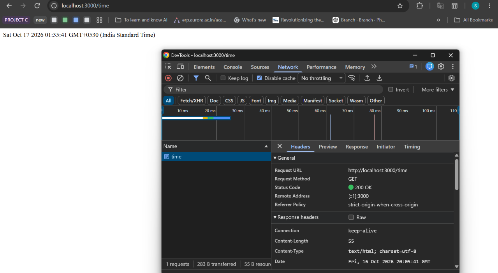
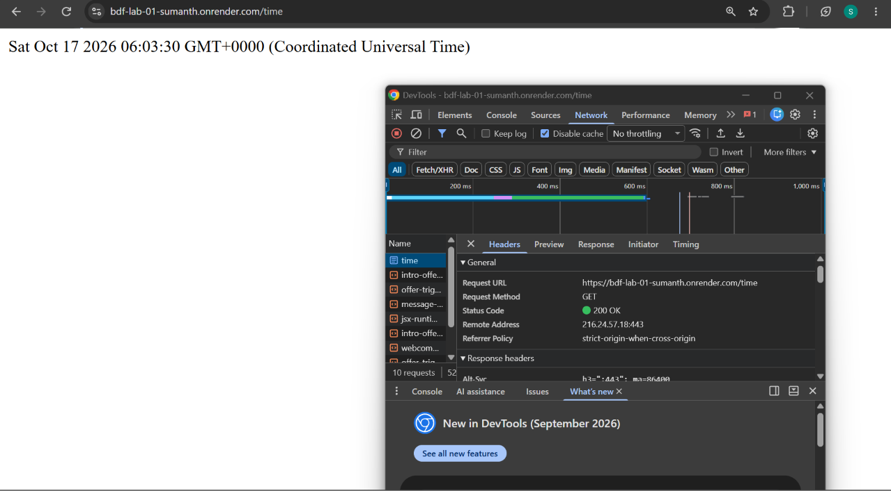
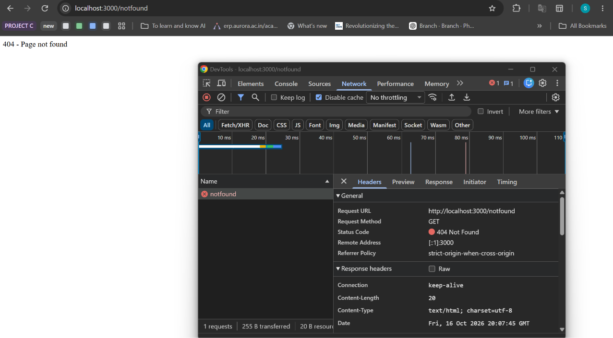
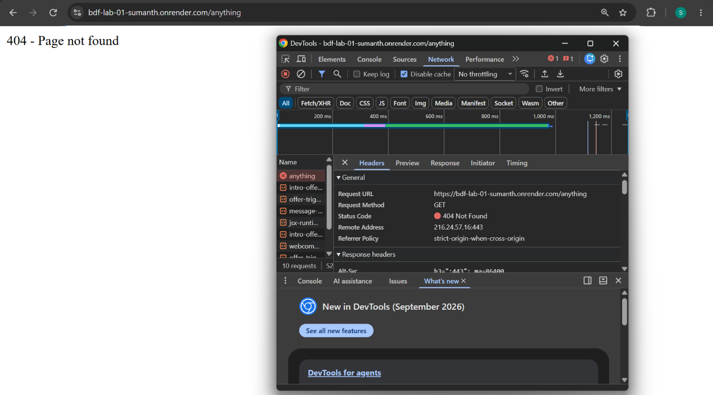

# BDF Lab 1: Node.js and Express Server

## Student Details

- **Name:** Sumanth
- **Registration Number:** Enter your registration number
- **Section:** 111 CSE GEN-AI 2B
- **Lab Number:** 01

## Live Deployment

**Platform:** Render

**Live URL:** To be added after deployment.

## Objective

To create a basic HTTP server using Node.js and develop an Express server with multiple routes, JSON responses, date and time output, and error handling for unknown routes.

## Technologies Used

- Node.js
- Express.js
- JavaScript
- npm
- Visual Studio Code
- Google Chrome

## Project Structure

```text
lab-01/
├── screenshots/
│   ├── home.png
│   ├── about.png
│   ├── time.png
│   └── not-found.png
├── .gitignore
├── package.json
├── package-lock.json
├── README.md
├── server-http.js
└── server.js
```

## Installation and Setup

### Prerequisites

Install Node.js and npm.

### Install Dependencies

Open the terminal in the project folder and run:

```bash
npm install
```

### Run the Express Server

```bash
node server.js
```

Open `http://localhost:3000` in your browser.

### Run the Original Node.js HTTP Server

```bash
node server-http.js
```

Stop the currently running server before starting another server on the same port.

## API Endpoints

| HTTP Method | Endpoint | Description | Status Code |
|---|---|---|---|
| GET | `/` | Displays a welcome message | 200 OK |
| GET | `/about` | Returns student details in JSON format | 200 OK |
| GET | `/time` | Displays the current date and time | 200 OK |
| GET | `/anything` | Returns a page-not-found message | 404 Not Found |

## Screenshots

### 1. Home Route

**Server Response**



**HTTP Status Code Verification**



### 2. About Route

**Server Response**



**HTTP Status Code Verification**



### 3. Time Route

**Server Response**



**HTTP Status Code Verification**



### 4. 404 Not Found

**Server Response**



**HTTP Status Code Verification**




## HTTP Status Codes

- **200 OK:** The request was successful.
- **404 Not Found:** The requested route does not exist.

## Result

Successfully created and tested a basic Node.js HTTP server and an Express server with multiple routes, JSON responses, date and time output, and 404 error handling.

## Viva Questions

**1. What is the difference between `package.json` and `node_modules`?**

`package.json` stores project details, scripts, and dependency information. `node_modules` contains installed packages.

**2. What does `app.listen()` do?**

It starts the Express server and listens for incoming requests on the specified port.

**3. What are request and response?**

The request contains information sent by the client. The response contains the information sent back by the server.

## Problems Faced

Record the actual issues faced during development and how they were resolved.

## Git Repository

Add the GitHub repository URL after uploading the lab files.
