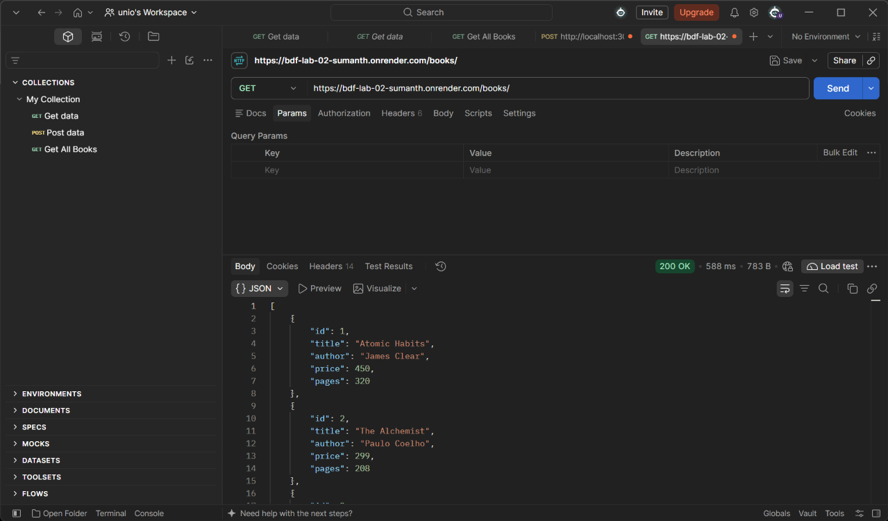
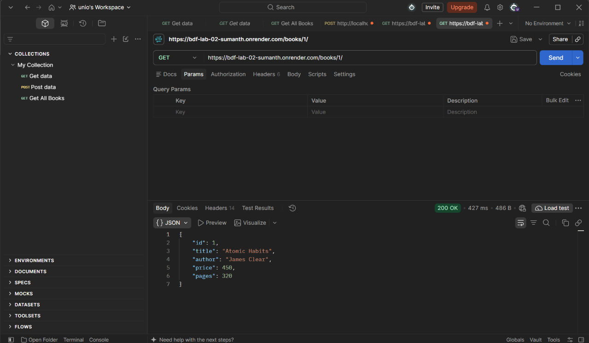
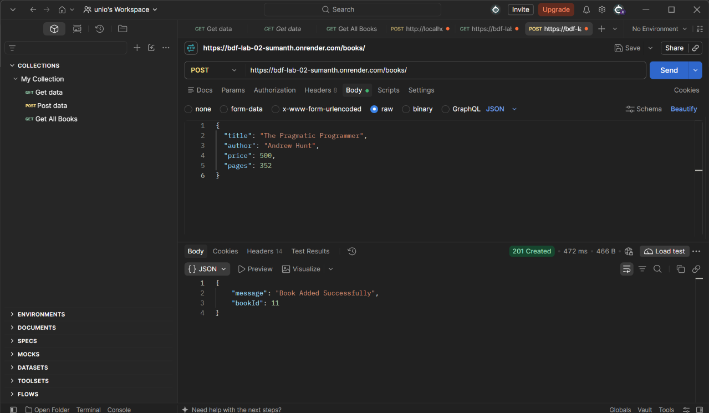
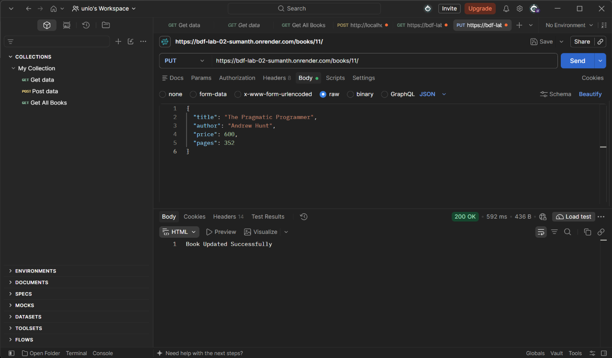
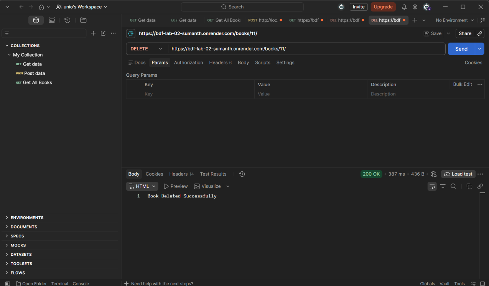
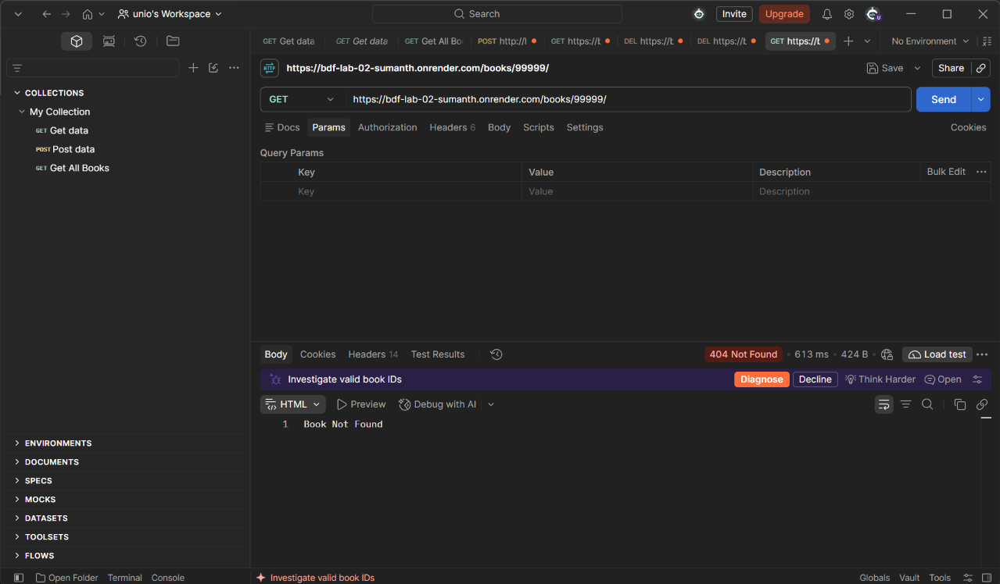
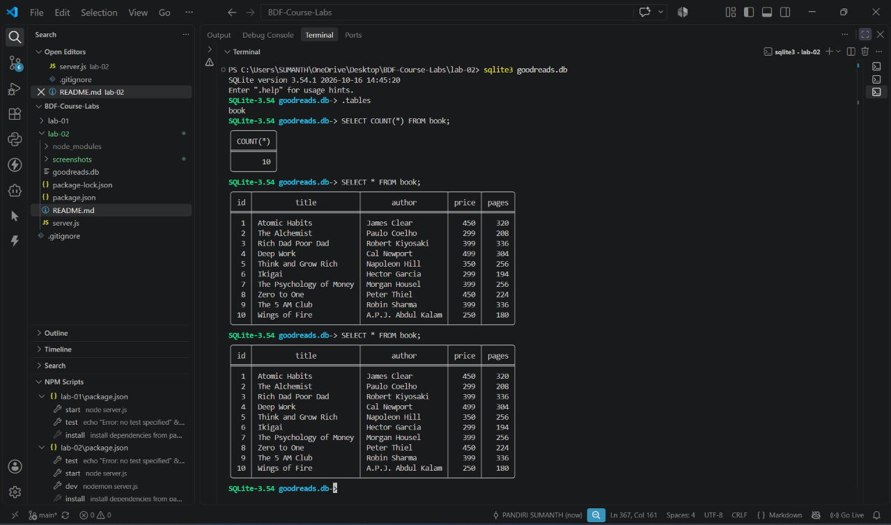
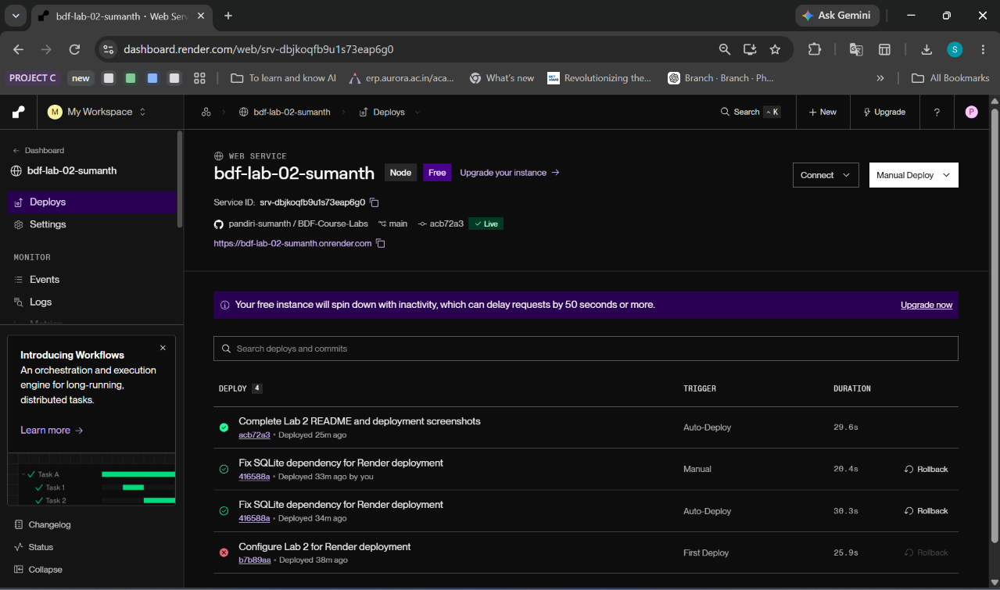
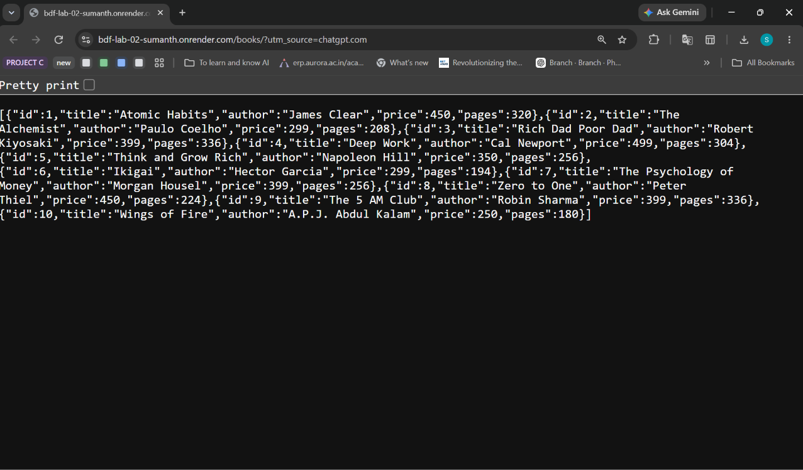

# Lab 2: SQLite Database and CRUD Routes

**Sumanth** · **252U1R9117** · **111 CSE GEN-AI 2B**

---

### Objective

To create a SQLite database and develop REST API endpoints using Node.js and Express.js to perform CRUD operations on book records.

### Project Details

- **Database:** SQLite
- **Database File:** `goodreads.db`
- **Table Name:** `book`
- **Backend:** Node.js and Express.js
- **SQLite Integration:** sqlite and sqlite3
- **Development Tool:** Nodemon
- **API Testing Tool:** Postman
- **Deployment Platform:** Render
- **Local Port:** 3000

---

### Live Deployment

- **Platform:** Render
- **Service Name:** bdf-lab-02-sumanth
- **Live Application:** https://bdf-lab-02-sumanth.onrender.com
- **GET All Books API:** https://bdf-lab-02-sumanth.onrender.com/books/

The application is successfully deployed on Render. The live GET All Books endpoint returns the 10 book records stored in the SQLite database.

---

### How to Run

#### 1. Prerequisites

- Node.js
- npm (Node Package Manager)
- SQLite CLI (`sqlite3`)
- Visual Studio Code
- Postman

#### 2. Clone the Repository

```bash
git clone https://github.com/pandiri-sumanth/BDF-Course-Labs.git
```

Navigate to the Lab 2 directory:

```bash
cd BDF-Course-Labs/lab-02
```

#### 3. Install Dependencies

Install the required packages:

```bash
npm install
```

#### 4. Database Setup

The project uses a SQLite database named `goodreads.db`.

The database contains a table named `book` with the following columns:

| Column | Data Type | Description |
|---|---|---|
| id | INTEGER | Primary key |
| title | TEXT | Book title |
| author | TEXT | Author name |
| price | INTEGER | Book price |
| pages | INTEGER | Number of pages |

Ten initial book records were inserted into the database using SQLite CLI.

To inspect the database:

```bash
sqlite3 goodreads.db
```

Display the available tables:

```sql
.tables
```

Display all book records:

```sql
SELECT * FROM book;
```

Exit SQLite:

```sql
.exit
```

#### 5. Start the Server

To start the development server using Nodemon:

```bash
npm run dev
```

Alternatively, start the application using Node.js:

```bash
npm start
```

The local server runs at:

```text
http://localhost:3000/
```

Expected terminal output:

```text
Database Connected Successfully
Server Running at port 3000
```

The application uses `process.env.PORT || 3000` to support both local execution and Render deployment.

---

### API Endpoints

The application implements five REST API endpoints to perform CRUD operations.

| Method | Endpoint | Status Code | Description |
|---|---|---|---|
| GET | `/books/` | 200 OK | Retrieves all book records. |
| GET | `/books/:bookId/` | 200 OK / 404 Not Found | Retrieves a book using its ID. |
| POST | `/books/` | 201 Created | Adds a new book to the database. |
| PUT | `/books/:bookId/` | 200 OK / 404 Not Found | Updates an existing book. |
| DELETE | `/books/:bookId/` | 200 OK / 404 Not Found | Deletes a book using its ID. |

#### 1. GET All Books

Endpoint:

```text
GET /books/
```

Retrieves all book records from the database.

#### 2. GET Book by ID

Endpoint:

```text
GET /books/1/
```

Retrieves a specific book using its ID.

If the book does not exist, the server returns `404 Not Found`.

#### 3. POST - Add a New Book

Endpoint:

```text
POST /books/
```

Sample request body:

```json
{
  "title": "Clean Code",
  "author": "Robert C. Martin",
  "price": 550,
  "pages": 464
}
```

A successful request returns `201 Created` along with the generated book ID.

#### 4. PUT - Update an Existing Book

Example endpoint:

```text
PUT /books/11/
```

Sample request body:

```json
{
  "title": "Clean Code",
  "author": "Robert C. Martin",
  "price": 600,
  "pages": 464
}
```

Updates the details of the selected book.

#### 5. DELETE - Remove a Book

Example endpoint:

```text
DELETE /books/11/
```

Deletes the selected book from the database.

Returns `404 Not Found` if the requested book ID does not exist.

---

### Screenshots

The following screenshots demonstrate API testing and database verification.

Save the actual screenshots inside the `screenshots` folder using the filenames shown below.

#### 1. GET All Books



#### 2. GET Single Book by ID



#### 3. POST Add New Book



#### 4. PUT Update Book



#### 5. DELETE Book



#### 6. GET Non-Existent Book



#### 7. SQLite Database Verification



#### 8. Render Deployment Verification



#### 9. Live API Response



---

### Important Concepts Learned

1. **SQLite:** A lightweight database used to store and manage structured data.
2. **Database Connection:** Connecting a Node.js application to SQLite using the `open()` function.
3. **CRUD Operations:** Creating, reading, updating, and deleting database records.
4. **Parameterized Queries:** Using `?` placeholders to safely pass user inputs into SQL queries.
5. **Express Routes:** Creating API endpoints to handle HTTP requests.
6. **Async/Await:** Managing asynchronous database operations.
7. **Nodemon:** Automatically restarting the server when monitored files change.
8. **REST API:** Using HTTP methods such as GET, POST, PUT, and DELETE to manage resources.
9. **Deployment:** Hosting a Node.js application online using Render.

---

### Problems Faced and Solutions

#### 1. Database File Location

- **Problem:** SQLite showed `no such table: book` when the database was opened from the parent project directory.
- **Solution:** Opened the correct database file from the `lab-02` directory.

#### 2. POST Request Body

- **Problem:** `request.body` was undefined when the POST request did not contain a valid JSON body.
- **Solution:** Used `app.use(express.json())` and configured Postman with Body → raw → JSON.

#### 3. Database Connection

- **Problem:** The server must not accept requests before the database connection is ready.
- **Solution:** Used an asynchronous `initializeDBAndServer()` function and awaited the SQLite connection before starting the Express server.

#### 4. SQL Injection

- **Problem:** Directly inserting user input into SQL queries creates SQL injection risks.
- **Solution:** Used parameterized queries with `?` placeholders and passed user values separately.

#### 5. SQLite Compatibility During Deployment

- **Problem:** The initial Render deployment failed because the installed SQLite native binary required a newer GLIBC version than the deployment environment provided.
- **Solution:** Changed the SQLite package dependency to `sqlite3@5.1.7`, updated the package files, and redeployed the application successfully.

#### 6. Render Port Configuration

- **Problem:** The application initially used a fixed port, which is unsuitable for Render's assigned port configuration.
- **Solution:** Used `process.env.PORT || 3000` to support both local execution and cloud deployment.

---

### Viva Questions and Answers

#### 1. Why do we use await for database calls?

Database operations are asynchronous. The `await` keyword waits for the database operation to complete before the next statement runs. This helps return the correct database result to the client.

#### 2. What is SQL Injection and how do placeholders prevent it?

SQL Injection is an attack where someone inserts harmful SQL commands through user input.

Parameterized queries use `?` placeholders to separate SQL commands from user-provided values. This helps prevent user input from being executed as SQL commands.

#### 3. When do we use PUT instead of POST?

- **POST:** Used to create a new record.
- **PUT:** Used to update an existing record using its ID.

POST usually creates another record when repeated. PUT with the same data and resource ID produces the same final resource state.

#### 4. What is SQLite?

SQLite is a lightweight relational database management system. It stores data in a local database file and does not require a separate database server.

#### 5. What is a primary key?

A primary key uniquely identifies each record in a database table. In this project, `id` is the primary key of the `book` table.

#### 6. What is the difference between db.all() and db.get()?

- `db.all()` retrieves all matching records.
- `db.get()` retrieves a single matching record.

#### 7. Why do we use Nodemon?

Nodemon automatically restarts the Node.js server when monitored files change. It helps during development.

#### 8. Why do we use parameterized queries?

Parameterized queries separate SQL commands from user-provided values. They help prevent SQL injection and make database queries safer.

---

### Conclusion

In this lab, I created a SQLite database and connected it to an Express.js application using Node.js. I implemented all five CRUD API endpoints to manage book records.

I tested the endpoints using Postman and verified database changes using SQLite CLI. I also deployed the application successfully on Render and tested the live GET All Books API.

This lab helped me understand SQLite integration, REST API development, parameterized SQL queries, asynchronous database operations, and application deployment.